# Kubernetes Cluster Architecture

A single-node **K3s** cluster running on a **Raspberry Pi 5** (`pi5`), backed by high-speed NVMe storage (`/mnt/nvme`). Inbound traffic is tunneled via Cloudflare Zero Trust into Traefik, which routes traffic across isolated namespaces hosting media, monitoring, AI proxying, container registry, torrenting, and automation services.

---

## Cluster Overview Diagram

```mermaid
graph TD
    %% Color Definitions
    classDef cloudflare fill:#A0D18C,stroke:#70A65A,color:#000;
    classDef traefik fill:#24A1C1,stroke:#176E84,color:#FFF;
    classDef grafana fill:#F29B38,stroke:#C87B2A,color:#000;
    classDef prometheus fill:#E6522C,stroke:#B0391A,color:#FFF;
    classDef telegraf fill:#2B7BB9,stroke:#1E5580,color:#FFF;
    classDef postgres fill:#336791,stroke:#234A69,color:#FFF;
    classDef redis fill:#DC382D,stroke:#9E241C,color:#FFF;
    classDef ai fill:#10A37F,stroke:#0B6B53,color:#FFF;
    classDef film fill:#00A4DC,stroke:#00759E,color:#FFF;
    classDef finance fill:#059669,stroke:#047857,color:#FFF;
    classDef litellm fill:#7C3AED,stroke:#5B21B6,color:#FFF;
    classDef photos fill:#4F46E5,stroke:#3730A3,color:#FFF;
    classDef portainer fill:#13BEBB,stroke:#0E8C89,color:#000;
    classDef registry fill:#2496ED,stroke:#1565C0,color:#FFF;
    classDef torrent fill:#3B82F6,stroke:#1D4ED8,color:#FFF;
    classDef storage fill:#64748B,stroke:#475569,color:#FFF;
    classDef limitrange fill:#94A3B8,stroke:#64748B,color:#000;
    classDef middleware fill:#CBD5E1,stroke:#94A3B8,color:#000;
    classDef secret fill:#FDE047,stroke:#CA8A04,color:#000;
    classDef cronjob fill:#C084FC,stroke:#9333EA,color:#000;

    User((User)) -->|HTTPS| CF_EDGE(("Cloudflare Edge<br>[*.marcodifrancesco.com]"))
    CF_EDGE -->|Tunnel| CF_TUNNEL(["Cloudflare Tunnel<br>[cloudflared]"])
    CF_TUNNEL -->|HTTP:80| TRAEFIK_SVC

    subgraph "Namespace: kube-system"
        subgraph "Traefik Ingress Controller"
            TRAEFIK_SVC{{"Service<br>[traefik]<br>(LoadBalancer :80/:443)"}}
            TRAEFIK_DEPLOY(["Deployment<br>[traefik]"])
            TRAEFIK_METRICS_SVC{{"Service<br>[traefik-metrics]<br>(ClusterIP)"}}

            TRAEFIK_SVC -. "port 80/443" .-> TRAEFIK_DEPLOY
            TRAEFIK_METRICS_SVC -. "port 9100" .-> TRAEFIK_DEPLOY
        end
    end

    %% Ingress Routing
    TRAEFIK_SVC -->|ai.marcodifrancesco.com| AI_SVC
    TRAEFIK_SVC -->|dashboard.marcodifrancesco.com| GRAF_SVC
    TRAEFIK_SVC -->|film.marcodifrancesco.com| FILM_SVC
    TRAEFIK_SVC -->|finance.marcodifrancesco.com/api| FIN_SVC
    TRAEFIK_SVC -->|litellm.marcodifrancesco.com| LLM_SVC
    TRAEFIK_SVC -->|photos.marcodifrancesco.com| PHOTO_SVC
    TRAEFIK_SVC -->|portainer.marcodifrancesco.com| PORT_SVC
    TRAEFIK_SVC -->|registry.marcodifrancesco.com| REG_SVC
    TRAEFIK_SVC -->|prowlarr.marcodifrancesco.com| TOR_PROW_SVC
    TRAEFIK_SVC -->|radarr.marcodifrancesco.com| TOR_RAD_SVC
    TRAEFIK_SVC -->|qbittorrent.marcodifrancesco.com| TOR_QBIT_SVC

    subgraph "Namespace: ai"
        AI_LR["LimitRange<br>[ai-limit-range]"]

        subgraph "Open WebUI"
            AI_SVC{{"Service<br>[open-webui]<br>(ClusterIP)"}}
            AI_DEPLOY(["Deployment<br>[open-webui]"])
            AI_VOL_DATA[("HostPath<br>[open-webui-data]")]
            AI_VOL_KEY[("HostPath<br>[gcp-key]")]

            AI_SVC -. "port 8080" .-> AI_DEPLOY
            AI_DEPLOY -. "mounts" .-> AI_VOL_DATA
            AI_DEPLOY -. "mounts" .-> AI_VOL_KEY
        end

        subgraph "SearXNG"
            AI_SEARX_SVC{{"Service<br>[searxng]<br>(ClusterIP)"}}
            AI_SEARX_DEPLOY(["Deployment<br>[searxng]"])

            AI_SEARX_SVC -. "port 8080" .-> AI_SEARX_DEPLOY
        end

        AI_DEPLOY -. "web search :80" .-> AI_SEARX_SVC
    end

    subgraph "Namespace: dashboard"
        DASH_LR["LimitRange<br>[dashboard-limit-range]"]
        DASH_MW["Middleware<br>[redirect-to-dashboard]"]

        subgraph "Grafana"
            GRAF_SVC{{"Service<br>[grafana]<br>(ClusterIP)"}}
            GRAF_DEPLOY(["Deployment<br>[grafana]"])
            GRAF_VOL[("HostPath<br>[grafana-data]")]

            GRAF_SVC -. "port 3300" .-> GRAF_DEPLOY
            GRAF_DEPLOY -. "mounts" .-> GRAF_VOL
        end

        subgraph "Prometheus"
            PROM_SVC{{"Service<br>[prometheus]<br>(ClusterIP)"}}
            PROM_DEPLOY(["Deployment<br>[prometheus]"])
            PROM_VOL[("HostPath<br>[config & tsdb-data]")]

            PROM_SVC -. "port 9090" .-> PROM_DEPLOY
            PROM_DEPLOY -. "mounts" .-> PROM_VOL
        end

        subgraph "Telegraf"
            TELE_SVC{{"Service<br>[telegraf]<br>(ClusterIP)"}}
            TELE_DEPLOY(["Deployment<br>[telegraf]"])
            TELE_VOL[("HostPath<br>[config, /proc, docker.sock]")]

            TELE_SVC -. "port 9273" .-> TELE_DEPLOY
            TELE_DEPLOY -. "mounts" .-> TELE_VOL
        end

        DASH_MW -. "redirect grafana. -> dashboard." .-> GRAF_SVC
        GRAF_DEPLOY -. "queries :80" .-> PROM_SVC
        PROM_DEPLOY -. "scrapes :80" .-> TELE_SVC
    end

    PROM_DEPLOY -. "scrapes :9100" .-> TRAEFIK_METRICS_SVC
    PROM_DEPLOY -. "scrapes :80" .-> LLM_SVC

    subgraph "Namespace: film"
        FILM_LR["LimitRange<br>[film-limit-range]"]
        FILM_MW["Middleware<br>[redirect-to-film]"]

        subgraph "Jellyfin"
            FILM_SVC{{"Service<br>[jellyfin]<br>(ClusterIP)"}}
            FILM_DEPLOY(["Deployment<br>[jellyfin]"])
            FILM_VOL[("HostPath<br>[config & media]")]

            FILM_MW -. "redirect jellyfin. -> film." .-> FILM_SVC
            FILM_SVC -. "port 8096" .-> FILM_DEPLOY
            FILM_DEPLOY -. "mounts" .-> FILM_VOL
        end
    end

    subgraph "Namespace: finance"
        FIN_LR["LimitRange<br>[finance-limit-range]"]
        FIN_MW["Middleware<br>[strip-api-prefix]"]

        subgraph "Finance API"
            FIN_SVC{{"Service<br>[finance-api]<br>(ClusterIP)"}}
            FIN_DEPLOY(["Deployment<br>[finance-api]"])
            FIN_VOL[("HostPath<br>[finance.db]")]

            FIN_MW -. "strips /api" .-> FIN_SVC
            FIN_SVC -. "port 54246" .-> FIN_DEPLOY
            FIN_DEPLOY -. "mounts" .-> FIN_VOL
        end
    end

    subgraph "Namespace: litellm"
        LLM_LR["LimitRange<br>[litellm-limit-range]"]
        LLM_CJ["CronJob<br>[litellm-restarter]<br>(0 2 * * *)"]

        subgraph "LiteLLM Proxy"
            LLM_SVC{{"Service<br>[litellm]<br>(ClusterIP)"}}
            LLM_DEPLOY(["Deployment<br>[litellm]"])
            LLM_VOL[("HostPath<br>[config & gcp-key]")]

            LLM_SVC -. "port 4000" .-> LLM_DEPLOY
            LLM_DEPLOY -. "mounts" .-> LLM_VOL
        end

        subgraph "LiteLLM PostgreSQL"
            LLM_PG_SVC{{"Service<br>[postgres]<br>(ClusterIP)"}}
            LLM_PG_DEPLOY(["Deployment<br>[postgres]"])
            LLM_PG_VOL[("HostPath<br>[postgres-data]")]

            LLM_PG_SVC -. "port 5432" .-> LLM_PG_DEPLOY
            LLM_PG_DEPLOY -. "mounts" .-> LLM_PG_VOL
        end

        LLM_DEPLOY -. "port 5432" .-> LLM_PG_SVC
        LLM_CJ -. "rollout restart" .-> LLM_DEPLOY
    end

    subgraph "Namespace: photos"
        PHOTO_LR["LimitRange<br>[photos-limit-range]"]
        PHOTO_MW["Middleware<br>[redirect-to-photos]"]

        subgraph "Immich Server"
            PHOTO_SVC{{"Service<br>[immich-server]<br>(ClusterIP)"}}
            PHOTO_DEPLOY(["Deployment<br>[immich-server]"])
            PHOTO_VOL[("HostPath<br>[/mnt/nvme/immich]")]

            PHOTO_SVC -. "port 2283" .-> PHOTO_DEPLOY
            PHOTO_DEPLOY -. "mounts" .-> PHOTO_VOL
        end

        subgraph "Immich Machine Learning"
            PHOTO_ML_SVC{{"Service<br>[immich-machine-learning]<br>(ClusterIP)"}}
            PHOTO_ML_DEPLOY(["Deployment<br>[immich-machine-learning]"])
            PHOTO_ML_VOL[("HostPath<br>[model-cache]")]

            PHOTO_ML_SVC -. "port 3003" .-> PHOTO_ML_DEPLOY
            PHOTO_ML_DEPLOY -. "mounts" .-> PHOTO_ML_VOL
        end

        subgraph "Immich PostgreSQL"
            PHOTO_PG_SVC{{"Service<br>[postgres]<br>(ClusterIP)"}}
            PHOTO_PG_DEPLOY(["Deployment<br>[postgres-vectorchord]"])
            PHOTO_PG_VOL[("HostPath & emptyDir<br>[data & /dev/shm]")]

            PHOTO_PG_SVC -. "port 5432" .-> PHOTO_PG_DEPLOY
            PHOTO_PG_DEPLOY -. "mounts" .-> PHOTO_PG_VOL
        end

        subgraph "Immich Redis"
            PHOTO_REDIS_SVC{{"Service<br>[redis]<br>(ClusterIP)"}}
            PHOTO_REDIS_DEPLOY(["Deployment<br>[valkey]"])

            PHOTO_REDIS_SVC -. "port 6379" .-> PHOTO_REDIS_DEPLOY
        end

        PHOTO_MW -. "redirect immich. -> photos." .-> PHOTO_SVC
        PHOTO_DEPLOY -. "port 5432" .-> PHOTO_PG_SVC
        PHOTO_DEPLOY -. "port 6379" .-> PHOTO_REDIS_SVC
        PHOTO_DEPLOY -. "port 80" .-> PHOTO_ML_SVC
    end

    subgraph "Namespace: portainer"
        PORT_LR["LimitRange<br>[portainer-limit-range]"]

        subgraph "Portainer CE"
            PORT_SVC{{"Service<br>[portainer]<br>(ClusterIP)"}}
            PORT_DEPLOY(["Deployment<br>[portainer]"])
            PORT_VOL[("HostPath<br>[data & docker.sock]")]

            PORT_SVC -. "port 9000" .-> PORT_DEPLOY
            PORT_DEPLOY -. "mounts" .-> PORT_VOL
        end
    end

    subgraph "Namespace: registry"
        REG_LR["LimitRange<br>[registry-limit-range]"]
        REG_SEC>"Secret<br>[registry-auth-secret]"]
        REG_MW["Middleware<br>[registry-auth]"]

        subgraph "Docker Registry"
            REG_SVC{{"Service<br>[registry]<br>(ClusterIP)"}}
            REG_DEPLOY(["Deployment<br>[registry]"])
            REG_VOL[("HostPath<br>[registry-data]")]

            REG_SEC -. "basicAuth" .-> REG_MW
            REG_MW -. "protects" .-> REG_SVC
            REG_SVC -. "port 5000" .-> REG_DEPLOY
            REG_DEPLOY -. "mounts" .-> REG_VOL
        end
    end

    subgraph "Namespace: torrent"
        TOR_LR["LimitRange<br>[torrent-limit-range]"]

        subgraph "Prowlarr"
            TOR_PROW_SVC{{"Service<br>[prowlarr]<br>(ClusterIP)"}}
            TOR_PROW_DEPLOY(["Deployment<br>[prowlarr]"])
            TOR_PROW_VOL[("HostPath<br>[prowlarr-config]")]

            TOR_PROW_SVC -. "port 9696" .-> TOR_PROW_DEPLOY
            TOR_PROW_DEPLOY -. "mounts" .-> TOR_PROW_VOL
        end

        subgraph "FlareSolverr"
            TOR_FLARE_SVC{{"Service<br>[flaresolverr]<br>(ClusterIP)"}}
            TOR_FLARE_DEPLOY(["Deployment<br>[flaresolverr]"])

            TOR_FLARE_SVC -. "port 8191" .-> TOR_FLARE_DEPLOY
        end

        subgraph "Radarr"
            TOR_RAD_SVC{{"Service<br>[radarr]<br>(ClusterIP)"}}
            TOR_RAD_DEPLOY(["Deployment<br>[radarr]"])
            TOR_RAD_VOL[("HostPath<br>[config & radarr-downloads]")]

            TOR_RAD_SVC -. "port 7878" .-> TOR_RAD_DEPLOY
            TOR_RAD_DEPLOY -. "mounts" .-> TOR_RAD_VOL
        end

        subgraph "qBittorrent"
            TOR_QBIT_SVC{{"Service<br>[qbittorrent]<br>(ClusterIP)"}}
            TOR_QBIT_DEPLOY(["Deployment<br>[qbittorrent]"])
            TOR_QBIT_VOL[("HostPath<br>[qbittorrent-config]")]

            TOR_QBIT_SVC -. "port 8080" .-> TOR_QBIT_DEPLOY
            TOR_QBIT_DEPLOY -. "mounts" .-> TOR_QBIT_VOL
        end

        TOR_PROW_DEPLOY -. "captchas :80" .-> TOR_FLARE_SVC
        TOR_PROW_DEPLOY -. "syncs" .-> TOR_RAD_SVC
        TOR_RAD_DEPLOY -. "downloads :80" .-> TOR_QBIT_SVC
    end

    %% Shared Media & Download Volumes
    SHARED_DL[("HostPath<br>[/mnt/nvme/qbittorrent-downloads]")]
    TOR_QBIT_DEPLOY -. "downloads to" .-> SHARED_DL
    TOR_RAD_DEPLOY -. "imports from" .-> SHARED_DL
    FILM_DEPLOY -. "reads" .-> SHARED_DL

    %% Apply Colors
    class CF_EDGE,CF_TUNNEL cloudflare;
    class TRAEFIK_SVC,TRAEFIK_METRICS_SVC,TRAEFIK_DEPLOY traefik;
    class GRAF_SVC,GRAF_DEPLOY grafana;
    class PROM_SVC,PROM_DEPLOY prometheus;
    class TELE_SVC,TELE_DEPLOY telegraf;
    class AI_SVC,AI_DEPLOY,AI_SEARX_SVC,AI_SEARX_DEPLOY ai;
    class FILM_SVC,FILM_DEPLOY film;
    class FIN_SVC,FIN_DEPLOY finance;
    class LLM_SVC,LLM_DEPLOY litellm;
    class LLM_PG_SVC,LLM_PG_DEPLOY,PHOTO_PG_SVC,PHOTO_PG_DEPLOY postgres;
    class PHOTO_SVC,PHOTO_DEPLOY,PHOTO_ML_SVC,PHOTO_ML_DEPLOY photos;
    class PHOTO_REDIS_SVC,PHOTO_REDIS_DEPLOY redis;
    class PORT_SVC,PORT_DEPLOY portainer;
    class REG_SVC,REG_DEPLOY registry;
    class TOR_PROW_SVC,TOR_PROW_DEPLOY,TOR_RAD_SVC,TOR_RAD_DEPLOY,TOR_QBIT_SVC,TOR_QBIT_DEPLOY,TOR_FLARE_SVC,TOR_FLARE_DEPLOY torrent;
    class AI_VOL_DATA,AI_VOL_KEY,GRAF_VOL,PROM_VOL,TELE_VOL,FILM_VOL,FIN_VOL,LLM_VOL,LLM_PG_VOL,PHOTO_VOL,PHOTO_ML_VOL,PHOTO_PG_VOL,PORT_VOL,REG_VOL,TOR_PROW_VOL,TOR_RAD_VOL,TOR_QBIT_VOL,SHARED_DL storage;
    class AI_LR,DASH_LR,FILM_LR,FIN_LR,LLM_LR,PHOTO_LR,PORT_LR,REG_LR,TOR_LR limitrange;
    class DASH_MW,FILM_MW,FIN_MW,PHOTO_MW,REG_MW middleware;
    class REG_SEC secret;
    class LLM_CJ cronjob;
```

---

## Namespaces & Workloads

| Namespace | Service / Deployment | Ingress Host |
|---|---|---|
| **`kube-system`** | `traefik` `traefik-metrics` | `192.168.1.101` |
| **`ai`** | `open-webui` `searxng` | `ai.marcodifrancesco.com` |
| **`dashboard`** | `grafana` `prometheus` `telegraf` | `dashboard.marcodifrancesco.com` *(redirect: `grafana.`)* |
| **`film`** | `jellyfin` | `film.marcodifrancesco.com` *(redirect: `jellyfin.`)* |
| **`finance`** | `finance-api` | `finance.marcodifrancesco.com/api` |
| **`litellm`** | `litellm` `postgres` `litellm-restarter` | `litellm.marcodifrancesco.com` |
| **`photos`** | `immich-server` `immich-machine-learning` `postgres` `redis` | `photos.marcodifrancesco.com` *(redirect: `immich.`)* |
| **`portainer`** | `portainer` | `portainer.marcodifrancesco.com` |
| **`registry`** | `registry` | `registry.marcodifrancesco.com` |
| **`torrent`** | `prowlarr` `flaresolverr` `radarr` `qbittorrent` | `prowlarr.marcodifrancesco.com` `radarr.marcodifrancesco.com` `qbittorrent.marcodifrancesco.com` |

---

## Architecture Details

### Ingress & Network Flow
1. **Cloudflare Zero Trust**: Public requests to `*.marcodifrancesco.com` terminate on Cloudflare Edge and pass through an encrypted tunnel (`cloudflared`) directly to the node.
2. **Traefik Ingress Controller**: Serves traffic on ports `80` and `443`, evaluating Kubernetes `Ingress` resources and applying custom middlewares.

### Persistent Storage
- Persistent volumes are backed by NVMe storage mounted on `/mnt/nvme`.
- Application configuration and runtime state reside in `/mnt/nvme/k8s/data/<namespace>/`.

### Resource Limits
- Every namespace enforces a baseline `LimitRange` standardizing default CPU/memory limits (`2 CPUs`, `1-2 GiB` RAM) and default requests (`100m CPU`, `128-256 MiB` RAM).
